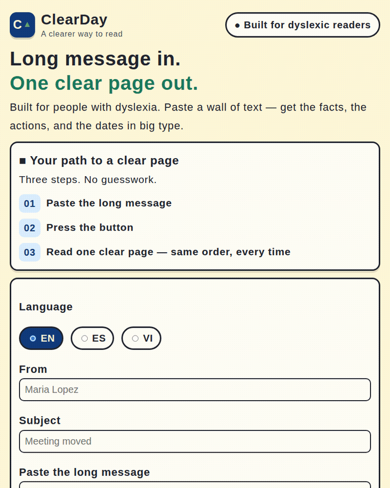

# ClearDay

**Long message in. One clear page out.**

**1 in 5 people has dyslexia** (Yale Center for Dyslexia & Creativity). A 40-line email goes in. **3 actions, a fact table, and the dates in big type** come out.



ClearDay is a personal agent built for people with dyslexia. It takes a long, hard-to-read email or document and turns it into one clear page, in the same order every time:

1. **WHAT THIS IS** — in one sentence
2. **YOU MUST DO** — at most 3 actions
3. **KEY FACTS** — who, what, where, in a table
4. **DATES + NUMBERS** — big type, one per line

Then ClearDay **remembers**. Its follow-up list shows what is still waiting for a reply, so nothing gets lost. It runs on a Fly.io Sprite — a small computer of its own that sleeps when idle, wakes in seconds, and keeps its memory on a persistent disk. It uses the Sprites **GitHub connector** (see the live connector check at `/connected`). Since Nov 24 it also uses a **Together AI model through a Sprites Custom API connector** — the model drafts the words, the rules keep the dates (see How it works).

**Live demo:** https://clearday-bnjwz.sprites.app/
**Connector proof:** https://clearday-bnjwz.sprites.app/connected

**Tested:** Smoke test **40/40** · Playwright browser test **43/43** · real bugs caught by the tests and fixed (see Testing).

Built for Fly.io **Hacksgiving**, November 23–29, 2026.

## How ClearDay meets the Hacksgiving rules

| Rule | Proof |
|---|---|
| Runs on a Fly.io Sprite | The live demo above *is* the Sprite — it sleeps when idle and wakes on your click |
| Uses at least one Sprites connector | **GitHub** — live proof at [/connected](https://clearday-bnjwz.sprites.app/connected); this repo itself was created through that connector, from inside the Sprite. **Together AI** (Custom API connector) — a live model drafts each page's words; the green pill on every result page proves it answered |
| Built during Hacksgiving week | Built and submitted **Monday, November 23, 2026** — the first day |

## Try it in 60 seconds

1. Open the **live demo**: https://clearday-bnjwz.sprites.app/
2. **Fastest test:** hit the green **“Load the sample email”** button. Two things happen at once: the form fills itself with a real sample board email — From, Subject, and the whole message, where you can read it — **and the same email is delivered into the demo inbox** (Mailpit), so it is waiting on the Inbox page too. Then press **Make it clear**. Two presses, nothing hidden — that is the whole product. The clear page itself is two columns on a wide screen: the reading column (What this is → You must do → Key facts → Dates + numbers) and, beside it, **If you do nothing**, the **Reply** draft button, and **Why the cream page?**
3. Or test it with the form: In **From**, type: `Maria Lopez`
4. In **Subject**, type: `Board meeting moved`
5. Copy the sample email below into **Paste the long message**, and press **Make it clear**.

> Hi everyone, I hope you are all doing well. I am writing with several updates about our board meeting and a few related items that have come up since last week. First, please note that the meeting originally scheduled for Monday November 23 has been moved, after a long discussion with the venue and several board members who had conflicts, to Tuesday November 24 at 5:15 PM. The meeting will be held in Room 4 and also on Zoom for those who cannot attend in person. Second, please reply to this email to confirm whether you can attend in person or on Zoom, and please do that before Friday November 27 so we can order the right number of chairs and print the right number of packets. Third, please bring your photo ID, because the building has changed its check-in rules. The agenda includes the budget, the gala report, and a vote. If you cannot attend, please send your proxy to the chair before the meeting. Thank you so much for everything you do, and I look forward to seeing you there. Warm regards, Maria

What comes out: one clear page — the meeting moved to **Tuesday November 24, 5:15 PM**, 3 things to do, the facts in a table, and every date in big type. Then check **Follow-ups**: ClearDay remembered it.

## See it — the whole trip, in pictures

**1. The form.** One box. Paste the long message.


**2. The clear page.** Same order every time: what this is, what you must do, the facts, the dates in big type.


**3. It remembers.** The follow-up list — what is still waiting for a reply.


---

## Three languages — built for the communities I serve

ClearDay works in **English, Español, and Tiếng Việt**. Pick the language on the form. The whole clear page comes back in that language — the labels, the steps, the fact table — and the date finder reads dates the way each language writes them:

| Language | A date, as written | What ClearDay finds |
|---|---|---|
| English | Tuesday November 24, 5:15 PM | Tuesday November 24 · 5:15 PM |
| Español | martes 24 de noviembre, 5:15 p. m. | martes 24 de noviembre · 5:15 p. m. |
| Tiếng Việt | ngày 24 tháng 11, 17 giờ 15 | ngày 24 tháng 11 · 17 giờ 15 |

Why these three: they are the languages of the families I serve in the South Bay — at my college district, in labor, and at Latinas Contra Cancer. A clear page only helps if it arrives in the language you dream in. Every translation was checked for plain, everyday wording — short phrases, no fancy words — because that is the rule for all three languages.

---

## Why this matters: dyslexia, in numbers

Every number below was checked on the source's own page. Sources are US institutions.

| Fact | Source |
|---|---|
| Dyslexia affects **20% of the population** — **1 in 5 children**, about **12 million children in the US** | Yale Center for Dyslexia & Creativity, Connecticut Longitudinal Study |
| Dyslexia is **life-long**, and represents **80–90% of all learning disabilities** | Yale Center for Dyslexia & Creativity |
| Schools identify only **0–4%** of students, even though scientific assessment finds **20%** — most dyslexic readers are never identified | Yale Center for Dyslexia & Creativity |
| The reading achievement gap appears **as early as first grade, and persists** | Yale Center for Dyslexia & Creativity |
| Undiagnosed, dyslexia is linked to **higher rates of dropout, unemployment, anxiety and depression**; studies estimate **almost 50% of prison inmates have dyslexia** | Yale Center for Dyslexia & Creativity |
| Dyslexia affects **boys and girls equally** | Yale Center for Dyslexia & Creativity (JAMA, 1990) |
| **15–20% of the population** have some symptoms of dyslexia, including slow or inaccurate reading, poor spelling, or poor writing | International Dyslexia Association (IDA), Dyslexia Basics |
| About **85%** of students classified with a learning disability have a **primary disability in reading and language processing** | International Dyslexia Association (IDA) |
| Between **12% and 20%** of individuals have some type of learning disability, and **dyslexia is the most common** one | NICHD / National Institutes of Health |

Dyslexia is **not** reversing letters, and it is **not** low intelligence. Yale defines it as an *unexpected* difficulty in reading in a person with the intelligence to be a much better reader. Dyslexic readers are slow readers — and, paradoxically, often very fast and creative thinkers, with excellent skills in reasoning, imagination, and seeing the big picture.

**The cost of a wall of text is real.** For 1 in 5 people, a long email is not a small annoyance. It is slow, error-prone work — and a missed date, a missed form, or a missed reply can cost a meeting, a benefit, or a job. The information was sent. It just never became usable.

ClearDay exists to close that last gap: not more text about the text, but the same facts, laid out the way a dyslexic reader can actually use them.

Sources:
- Yale Center for Dyslexia & Creativity — https://dyslexia.yale.edu/update-connecticut-longitudinal-study-cls/
- Yale Center for Dyslexia & Creativity, *Speaking with One Voice* — https://dyslexia.yale.edu/wp-content/uploads/2017/08/YCDC-Guide-to-Talking-About-Dyslexia_Final032017.pdf
- International Dyslexia Association, Dyslexia Basics — https://dyslexiaida.org/dyslexia-basics/
- International Dyslexia Association, Definition of Dyslexia (adopted October 22, 2025) — https://dyslexiaida.org/definition-of-dyslexia/
- NICHD / NIH — https://www.nichd.nih.gov/about/profiles/KnowNICHD/miller

---

## Inspiration — my story, why I built this

It starts the way it always starts: one long email. The meeting moved. Confirm by Friday. Bring your photo ID. Send a proxy if you cannot come. For most people, 30 seconds. For me, that email is a wall — and somewhere in the wall is a date I cannot afford to miss.

My name is **Jose Luis Pacheco**. I live with severe dyslexia. It is personal to me.

I have coped the same way my whole life: by turning long written material into **graphs, tables, and charts** by hand. That is not a preference. It is how my brain takes in information. Reading long text is slow, halting work. I can miss a date or a deadline buried in a long page.

I have still built a full life and career on top of that — public service, board rooms, and work where the reading never stops. But the cost is paid every single day, in time and in risk, one long document at a time.

So for Hacksgiving I built the tool I needed first: **ClearDay**. It does to every long message what I have always had to do by hand — it turns words into a table, in a fixed order, with the dates and numbers big and impossible to miss. Then, because a Sprite remembers, it does not let the message be forgotten.

I built it for people who suffer from dyslexia. If it helps one person catch the one date that mattered, it was worth building.

— Jose Luis Pacheco, Campbell, California

**Hear it in my own voice** — this is me, speaking for myself, not a bio written about me:

- [SDAC, October 24, 2024 — Jose Luis Pacheco, speaking to board members during his first term on the CalPERS Board of Administration (2022–2026)](https://www.youtube.com/watch?v=S0sxcC-EQrg)

ClearDay is my personal project. I worked on it on my own breaks, on my personal accounts. It is not a District project.

From that talk: I am an IT professional at the San Jose Evergreen Community College District, where I have worked since 2015. I am a past president of CSEA Chapter 363 and a former South Bay Labor Council delegate. I serve on the board of Latinas Contra Cancer. I hold two bachelor's degrees — economics, and biological sciences. I did all of that reading the way I read: slowly, carefully, and with tables and charts doing the heavy lifting. That is the reader ClearDay is built for.

## Serving others — and thankful for it

My whole career has one shape: serving other people.

| Where I served | Who it was for |
|---|---|
| CalPERS Board of Administration | The retirees and workers whose pension money had to be guarded with care |
| CSEA Chapter 363, as president | School employees — so nobody works a lifetime in public service and retires with nothing |
| South Bay Labor Council, as a delegate | Working families across the South Bay |
| Latinas Contra Cancer, board chair | Latina women and families facing breast cancer and its disparities |
| My day job in IT since 2015 | The students and staff of a community college district |

I am thankful — for every teacher, colleague, and friend who ever handed me a chart instead of a chapter, and for every chance I have had to serve. ClearDay is that same service, in software: helping people get the message without fighting the page. Serving others is the work. This is just my newest way of doing it — and I think it is an awesome one.

---

## Testing — checked the way a judge will use it

| Test | What it proves | Result |
|---|---|---|
| **Smoke test** (inside the Sprite, against the live service) | Form loads · sample email gives the **exact 4 dates, none invented** · **green pill proves the live model answered** · connector check names the GitHub user · pasted code never renders raw · giant pastes refused · **sample button fills the form** · **inbox lists the real email · inbox clear flow in 3 languages** · bogus message id falls back safely · delete-all → inbox re-seeds itself · raw Mailpit through the proxy · **fake-data probes: a dateless email invents no date · a one-date email shows exactly that date · numbers copied to the cent · Spanish dates exact** · **reply loop: draft first (nothing sent) → reader edits the box → Send press delivers the edited words → follow-up closes** · **a send addressed to anyone but the real sender is refused** · **write-block probes: send/delete through the public proxy → 403, inbox intact** | **39 of 39 PASS** — log in `tests/smoke-test-2026-11-24.log` (Nov 23 run: 6 of 6, `tests/smoke-test-2026-11-23.log`) |
| **Playwright browser test** (TypeScript, real Chromium, public demo) | A judge's path: open → fill → submit → clear page → follow-ups, with screenshots · cream background exact · body text 21px · left-aligned · **the sample-button path, clicked like a judge** · **the inbox path: nav → Inbox → Make it clear** · **the reply walk: draft → thinking banner → draft page → edit the words → send** · **the blinking “AI is thinking” banner, checked on both waits** · inbox in Spanish · seed button adds a real email | **43 of 43 PASS** — script, log, and screenshots in `tests/` |

One honest note: the Playwright test first caught a real miss — the page body itself was 16px, under the 21–22px design rule, even though every visible element was sized right. The test failed, the CSS was fixed (one line), and the re-run passed 21 of 21. That is what the tests are for.

Second honest note (Nov 24): the green sample button first shipped **untested** — it jumped straight to the result and never showed the email in the form. The builder found it himself, in one press. The button now **fills the form first**, where the reader can see it, and the button path is inside both test suites (smoke check 8; five Playwright checks). A feature is not tested until the test touches it.

Third honest note (Nov 24): the rule paid for itself the same day. The first smoke run with the new inbox checks **failed at the last check** — the inbox path had saved a follow-up in the wrong shape, and the follow-ups page crashed on it (KeyError: 'what'). No judge ever saw it; the test caught it, the shape was fixed, and the re-run is 10 of 10.

## Challenges we ran into

| Challenge | What happened |
|---|---|
| A public demo can be misused | Anyone can paste anything into a public form — so all output is escaped, entries are capped, and every result page is labeled as visitor-made. A red-team check found this; it was fixed before submission |
| My own design rule, broken quietly | The Playwright test caught the page body at 16px — under the 21–22px rule — even though every visible element looked right. One line of CSS fixed it; the re-run passed 21 of 21 |
| Three languages, three date systems | Spanish writes *martes 24 de noviembre, 5:15 p. m.*; Vietnamese writes *ngày 24 tháng 11, 17 giờ 15*. Each needed its own date finder — and a translation checker caught 6 wording fixes before launch |
| A Sprite is a real little computer | Services, restarts, and persistent memory all had to be learned and verified live — nothing was assumed from the docs alone |
| Finding a model that could actually answer | The famous small models (Llama 3.1 8B, Qwen2.5 7B) were **not serverless** on my Together account — Together said so itself. Two reasoning models spent the whole token budget thinking and returned an empty page. **DeepSeek V4.1 Flash** answered clean JSON in about 6 seconds — and whenever any model cannot answer, ClearDay's rules answer alone, instantly |

## Accomplishments I am proud of

| Accomplishment | Proof |
|---|---|
| Built, tested, and submitted on **day one** of Hacksgiving week | This repo + the submission confirmation, Nov 23 |
| The connector did real work | The GitHub repo itself was **created through the Sprites GitHub connector**, from inside the Sprite |
| Tested like it matters | Smoke test 40/40 · Playwright 43/43 · the failures in between, shown honestly in Testing |
| A real inbox, on purpose | Mailpit runs on the same Sprite — judges see the raw, unfriendly inbox AND the clear page it becomes |
| It answers back — with permission | The AI drafts the reply, you read and edit it, and only your Send press sends it — then the follow-up closes |
| A real model, proven on the page | Every result page carries a pill, modeled on my Solvia app: green **AI: live model response** with the model name when the model answered — or **Rules: instant answer** when it did not. Judges never have to take my word for it |
| Three languages at launch | English · Español · Tiếng Việt — the languages of the families I serve |
| It helps the builder first | I am the first user. ClearDay reads my board email the way I have always needed it read |

## What I learned

A demo is not done when it works for the builder. It is done when it survives strangers, tests, and a tired judge at midnight — in their language, at their pace. And the test you almost skip is the one that finds the 16px.

## How ClearDay is designed for dyslexic readers

Design rules follow the International Dyslexia Association's guidance and WCAG 2.2 AA / ADA / Section 508 practice:

- Cream background (#FFF6D6), never pure white; dark text, never pure black on white
- Arial / Verdana sans-serif, body text 21–22px, line height 1.7, extra letter spacing
- Left-aligned, one column, short lines
- Bold only — no italics, no underlining
- Every section has a **big label + a shape + a color** — never color alone, and never red/green as a meaning pair
- Dates and numbers are **copied exactly from the source, never invented**
- The same page order, every time — no surprises to re-learn
- Page polish — brand top bar, hero headline, numbered path card, pill badges — is modeled on **Solvia**, my parking-permit app. The accessibility rules above never change; only the polish does

## Why it looks like 1997 — on purpose

Judges, one honest paragraph before the table: yes, this page would look at home on a 1997 school computer. That is not nostalgia and it is not a missing stylesheet. Every "old-looking" choice below is a **measured reading intervention** for dyslexic readers, tested in eye-tracking labs and classrooms. Modern web fashion — pure-white pages, thin gray text, small type, justified columns — is exactly what the research tells us to remove. Solvia, my other app, wears the modern clothes; ClearDay borrows Solvia's polish (top bar, hero, path card, pills) and keeps the research underneath.

| What looks old | Why it stays | The research |
|---|---|---|
| **Cream background (#FFF6D6)**, never pure white | Warm backgrounds — peach, cream, yellow — tested **best** for dyslexic readers; cool colors (blue, green, blue-gray) tested worse. Pure white with pure black glares and can make letters swim | Rello & Baeza-Yates, eye-tracking research on text presentation for dyslexia (summarized by the Rhode Island Dept. of Education) |
| **Arial / Verdana, bold only** — no italics, no underlining | With 48 readers with dyslexia tracked by eye movement, sans-serif roman fonts (Arial, Helvetica, Verdana, Courier) read fastest — and **italics read significantly slower** | Rello & Baeza-Yates, *Good Fonts for Dyslexia*, ACM ASSETS 2013 |
| **Big type (21–22px)**, line height 1.7 | Larger type improved objective readability and comprehension for dyslexic readers in the same research program | Rello & Baeza-Yates, *Universal Access in the Information Society* |
| **Extra letter spacing** (.04em) | Dyslexic readers are hurt by **crowding** — letters packed tight interfere with each other. Extra-large spacing **cut reading errors in half** in 74 dyslexic children, with no training at all | Zorzi et al., *PNAS* 2012 — [pubmed.ncbi.nlm.nih.gov/22665803](https://pubmed.ncbi.nlm.nih.gov/22665803/) |
| **Short lines, one narrow column**, left-aligned | Short lines gave **27% faster reading**, 11% fewer eye fixations, and backward eye jumps cut by more than half — at **no cost to comprehension** — in 103 high-school students with dyslexia | Schneps et al. (Harvard / Smithsonian), *PLoS ONE* 2013 — [journals.plos.org](https://journals.plos.org/plosone/article?id=10.1371%2Fjournal.pone.0075634) |
| **Label + shape + color** on every box — never color alone | A legal floor, not a preference: information must never be carried by color only, and text spacing must survive adjustment | WCAG 2.2 AA §1.4.1 and §1.4.12 — the standard Section 508 and the ADA point to |

And the authority behind the whole design: **Yale**. Dr. Sally Shaywitz, co-director of the Yale Center for Dyslexia & Creativity, puts it in one line: **“Dyslexia robs a person of time; accommodations return it.”** Yale's research shows dyslexic readers decode print through a slower, non-automatic pathway — so a 40-line email is not a small task, it is a time tax. ClearDay is an accommodation in Yale's sense: it does the slow decoding work once, then hands back a page the reader can actually use — facts in a table, actions in order, dates in big type. (Yale Center for Dyslexia & Creativity, [“Time & Tools”](https://dyslexia.yale.edu/resources/accommodations/time-and-tools/))

## The inbox — Mailpit, on purpose

ClearDay also has a **real inbox**, and you can watch email arrive in it:

The **home page itself** opens with a slim strip carrying Jose Luis's invitation, in his own words: *“Before you judge this app, please take a moment to experience what it is like to be dyslexic.”* Beside it, two doors: **See for yourself — Mailpit**, which opens the raw inbox in a **dialog window over the page — landing on Maria's email already open**, no hunting, no extra click (the judge steps straight inside the ugly original and feels how hard it is to read; the sample now arrives like real email, with both a text and a web-page version, so the reading pane can never open blank), and **Read my story**, which opens his full narrative in a second dialog: *“…can take me three tries to read it slowly before it gives up its meaning to me. Everything hides at first… That is why I created ClearDay.”* The strip stays small on purpose — the page belongs to the solution; the problem is one honest click away. Maria's email is guaranteed to be in Mailpit: the demo puts it there itself, whichever page a judge opens first.

1. **[Open the Inbox page](https://clearday-bnjwz.sprites.app/inbox)** — ClearDay's clear-style list of what is sitting in the inbox right now. Press **Make it clear** on any message.
2. **[Open the raw inbox — Mailpit](https://clearday-bnjwz.sprites.app/mailpit/)** — the same inbox in Mailpit's own screen: small, dense, gray text.

One safety line, found by a red-team probe and fixed the same day: the public Mailpit door is **look-only** — anyone can read the demo inbox, but sending or deleting through it is closed (403). Nobody can plant mail in this inbox.

The Mailpit screen is **not dyslexia-friendly — and that is the point.** That cramped gray list is what every inbox looks like to a dyslexic reader. ClearDay is the layer that fixes it. Mailpit is a real mail service (real SMTP, real storage) running as a second service on the same Sprite; the sample board email was really sent into it, and the Inbox page re-sends it if the box is ever empty. *(The GIF above shows the paste path; the inbox is a second door to the same clear page.)*

**And it replies — with your permission.** On a clear page opened from the inbox, **Draft a reply** has the AI write a short reply (only the email's real dates allowed in it) — and then it **stops**. You read the draft on its own page, **edit any words in the box**, and only your second press — **Send this reply** — sends it back to the sender through Mailpit. Nothing is ever sent without that press. The follow-up for that message is then marked done. While the AI works — clearing or drafting — a big blinking banner says **“AI is thinking”**, so the wait is never a blank screen. From the paste form, the same button drafts the reply for you to see — and if that sender's real address is sitting in the inbox (the sample always is), the draft page says so in the open and gives you the Send button right there; no match, no button, and the page says why. After a send, the REPLY SENT page points you to your sent email — it lands in the same inbox, visible in ClearDay's list and in Mailpit itself.

## How it works

```
  PASTE A LONG MESSAGE
          |
          v
  +------------------------------+
  |  SPRITE: clearday            |
  |  transform -> clear page     |
  |  memory.json -> follow-ups   |
  +------------------------------+
          |                \
          v                 v
  ONE CLEAR PAGE      GITHUB CONNECTOR
  (same order,        (this repo was made
   every time)         through it)
```

| Step | What happens |
|---|---|
| 1. Paste | A long email or message goes into the form |
| 2. Transform | **Rules first:** dates and numbers are extracted exactly (`clearday.py`). **Then the model:** a Together AI model (DeepSeek V4.1 Flash, through a Sprites Custom API connector) drafts the summary, actions, and facts — words only, never dates. If the model is slow or down, the rules answer alone |
| 3. Render | One clear page comes out (`render.py`), same order every time — topped with the pill that says who answered: the model, or the rules |
| 4. Remember | The follow-up is saved to `memory.json` on the Sprite's persistent disk |
| 5. Follow up | `/followups` shows what is still waiting for a reply |
| 6. Connectors | `/connected` calls GitHub through the Sprites GitHub connector gateway; the model is called through a Sprites Custom API connector — no key in the code, and no key inside the Sprite |

## Run it

```bash
python3 app.py            # serves on port 8080 (or $PORT)
```

On a Sprite, `app.py` runs as the `http` service on port 8080, which serves the Sprite's own URL. Set `CLEARDAY_GITHUB_GATEWAY` to the connector gateway URL copied from the connector's page in the Fly dashboard, and grant the connector access by Sprite name in its access policy.

The model is on in production: `CLEARDAY_MODEL_URL` points at a Sprites Custom API connector for Together AI and `CLEARDAY_MODEL` is `deepseek-ai/DeepSeek-V4.1-Flash-1017`. The model drafts words only — dates and numbers always come from the built-in rules, and if the model does not answer, the rules answer alone. Cost per email at Together's prices: about a tenth of a cent.

## Files

| File | Job |
|---|---|
| `app.py` | Web app + follow-up memory + connector check |
| `clearday.py` | The transform: text in, clear facts out |
| `render.py` | The dyslexia-friendly page |
| `sample_email.txt` | The demo email used in testing |

## Submission (Hacksgiving)

ClearDay — a persistent accessibility agent on a Fly Sprite that turns long, hard-to-read messages into one clear page for people with dyslexia, then remembers and follows up. Built by Jose Luis Pacheco, who lives with severe dyslexia, during Hacksgiving week.

## What's next

Real readers. The next step is putting ClearDay in front of dyslexic readers in my own communities — my college district and the Latinas Contra Cancer network — and letting their feedback set the next version. A tool for readers should be judged by readers.
